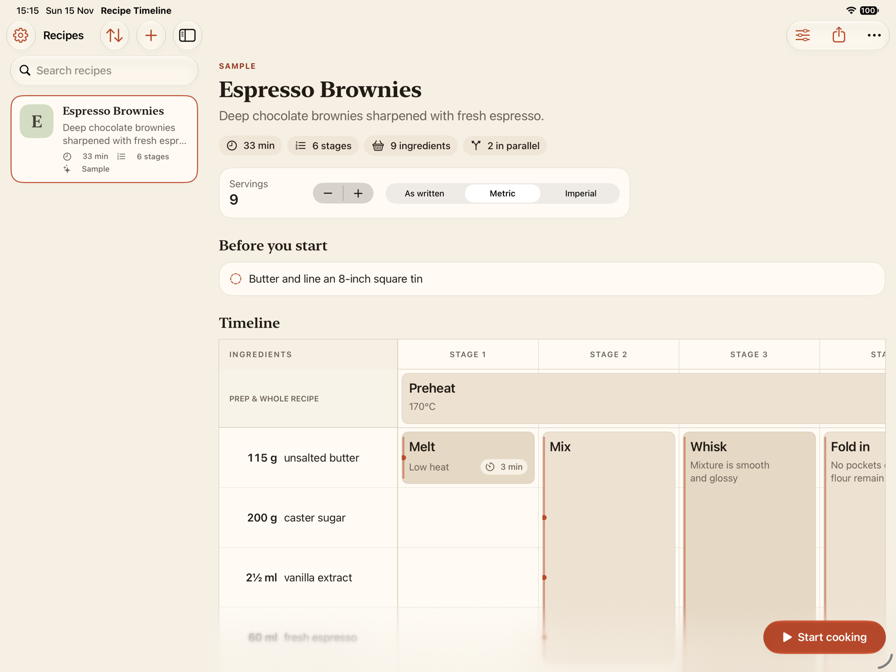
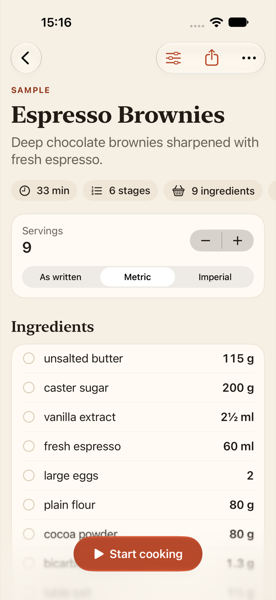
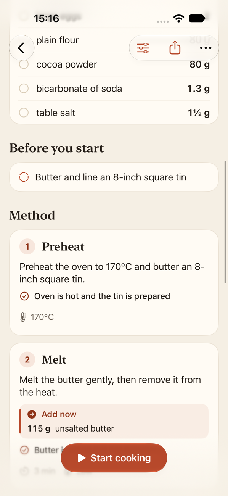
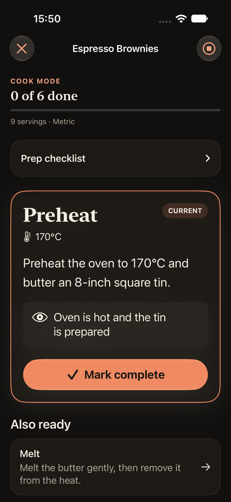

# Recipe Timeline

Recipe Timeline turns any recipe into a cooking plan you can actually follow. Instead of a wall of numbered steps, it shows what happens when, what can run in parallel, and exactly which ingredients go in at each stage — then walks you through it, one step at a time, while you cook.

It's a universal app for iPhone and iPad running iOS and iPadOS 27.

  
  &nbsp;
  
  &nbsp;
  

## What it does

### Bring in recipes from anywhere

- **Paste a link** to a recipe page.
- **Paste the text** of a recipe from a note, message or email.
- **Scan cookbook pages** with the document camera, or **choose photos or PDFs** — up to four pages per recipe.

Recipe Timeline reads the source, works out the ingredients, stages and timings, and checks the result before saving it. If something in the original is ambiguous, it flags the uncertainty instead of guessing.

### Create a recipe from a description

Describe what you'd like to cook, such as a dish, what's in the fridge, a diet or how long you've got, and Recipe Timeline writes a recipe for it in your units, looking things up on the web when that helps. Review the draft, then send it back with changes as often as you like ("make it vegetarian", "for six people"), undo a change that didn't work out, and save it when it's right. The pages it consulted are listed with the recipe.

### See the whole recipe at a glance

On iPad the recipe becomes an editorial timeline. Ingredients sit on the left, stages flow across the page, independent work (say, melting butter while the oven heats) runs side by side, and stages that bring things together span every ingredient they combine. On iPhone the same recipe is presented as clear, focused step cards.

Each recipe shows its estimated total time along the critical path, how many stages can happen in parallel, and a "before you start" checklist.

### Cook at any size, in your units

- Scale to any number of servings, with friendly kitchen fractions (½, ⅓, ¼) for spoons and cups.
- Switch between the recipe as written, metric and US measures. Spoon measures stay as written, and metric amounts are rounded to what you can weigh or measure.
- Every step tells you exactly how much to **add now**, already scaled.

### Cook mode that keeps up with you

- Focuses on the step you're on and shows what else is ready to start.
- Runs several timers at once, with notifications when they finish.
- Keeps the screen awake while you cook, and shows progress in a **Live Activity** on the Lock Screen and in the Dynamic Island.
- Remembers where you were, including your servings and units, if you leave and come back.

### Shop and swap

- **Substitutes**: ingredients with a common swap show a ⇄ button. It lists what can stand in, such as oil for melted butter or a flaxseed egg, with amounts scaled to your servings and units, and says how each one changes the result.
- **Shopping list**: add the ingredients to any list in **Reminders**, at the servings you've chosen. Anything you've ticked off as gathered is left out, and items already on the list are updated rather than added twice.

### Make it yours

- Edit any recipe: ingredients, stages and timings. On iPad, drag stages around; on iPhone, reorder them in a list.
- Export a recipe as a **PDF**, an **Excel spreadsheet** or a **PNG** image, at your chosen serving size and units.
- Search and sort your library, and pick up where you left off with **Continue cooking**.

## Privacy

Your recipe library syncs between your devices through your own private iCloud database; if iCloud isn't available, it's kept on the device. Signing in with Apple is only needed to import recipes.

Substitutes come from a catalogue built into the app, so looking them up sends nothing anywhere. Shopping lists are written straight to Reminders on your device, and the app asks for access the first time you add one.

Descriptions and requested changes are sent to the recipe service only to write the recipe, and aren't kept. Cookbook photos are used only to read the recipe: they're sent for that one request and never stored in your library. The import service doesn't log or keep what you send it or the recipes it returns. See [Architecture](docs/architecture.md#data-boundaries) for the details.

## Status

Recipe Timeline is in private testing through TestFlight.

## For developers

- [Development guide](docs/development.md) — building the app, running the tests, signing, and the import service.
- [Architecture](docs/architecture.md) — the canonical recipe model, timeline layout, persistence and cook state.
- [Import service](services/import-api/README.md) — the Cloudflare Worker that turns sources into recipes.
